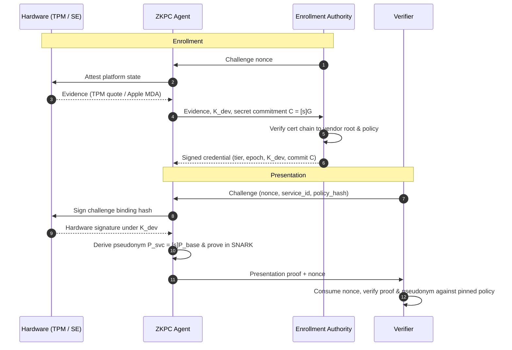

# ZKPC

**Zero-Knowledge Proofs for Hardware-Bound Credentials**

ZKPC explores using zero-knowledge proofs to verify hardware-bound credentials without exposing the device's hardware public key to the verifier.

The design combines platform attestation, signed credentials, P-256 ECDSA verification inside an R1CS circuit, and service-specific pseudonyms derived from a committed secret.

## Protocol

Enrollment Authority (EA) validates platform evidence and issues a credential binding the device key $K_{\mathrm{dev}}$ to a secret commitment:

$$
\mathcal{C} = [s]G
$$

For a verifier challenge bound to a service and policy, the device signs the challenge using its hardware key and generates a proof of credential validity, key possession, and pseudonym consistency.

The service-specific pseudonym is:

$$
P_{\mathrm{svc}} = [s]P_{\mathrm{base}}
$$

$$
P_{\mathrm{base}} = \mathrm{hash\_to\_curve}(\mathrm{service\_id})
$$

The construction uses RFC 9380 hash-to-curve with Simplified SWU on P-256.

Hardware assurance depends on correct platform-attestation validation and credential issuance. The proof establishes only the cryptographic relationships enforced by the implemented circuit.

## Protocol flow

## Cryptographic implementation

ZKPC uses R1CS circuits and the Vega proving infrastructure. The P-256 coordinate field is matched to `halo2curves::t256::Fq`, allowing native coordinate arithmetic. ECDSA scalar operations remain modulo the curve order $n$.

$$
w = s_{\mathrm{sig}}^{-1} \pmod n
$$

$$
u_1 = e \cdot w \pmod n, \qquad u_2 = r \cdot w \pmod n
$$

$$
R = u_1 G + u_2 Q, \qquad x(R) \bmod n = r
$$

Here, $s_{\mathrm{sig}}$ is the ECDSA signature scalar, distinct from the committed secret $s$.

## Status

Still cooking 🍳. Active development is underway on end-to-end integration, performance tuning, and hardware harness validation.

## License

Apache License 2.0. See `LICENSE`.
