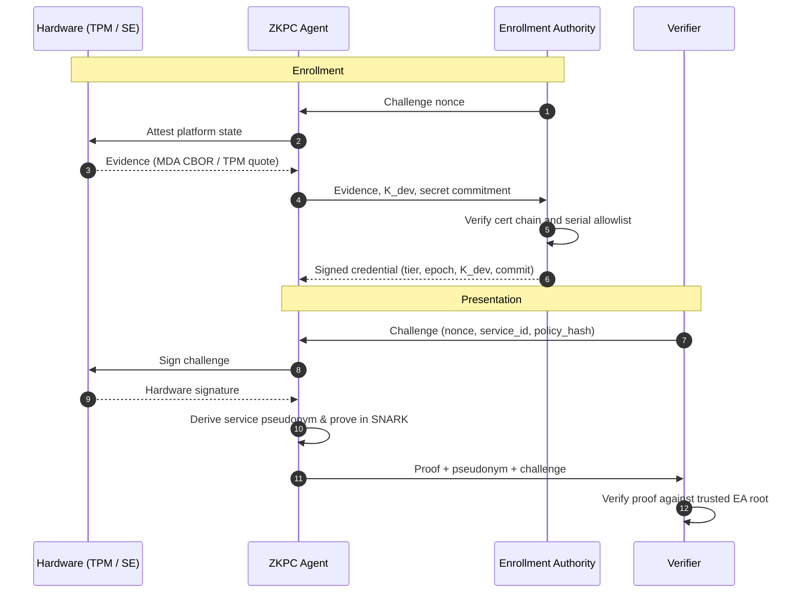

# ZKPC — Zero-Knowledge Proof of Conformance

Hardware-backed conformance proofs with privacy-preserving presentations.

<p>
  <a href="#primitive-benchmarks-standalone-ecdsa-circuit"></a>
  <a href="LICENSE"></a>
  <a href="https://csrc.nist.gov/publications/detail/fips/186/4/final"></a>
  <a href="#primitive-benchmarks-standalone-ecdsa-circuit"></a>
</p>

---

Hardware attestation (Apple Secure Enclave, TPM 2.0) ties keys to physical chips and boot state, but exposes stable identifiers—serial numbers and public keys—to every verifier. Software credentials protect privacy, but can be copied to rogue emulators as bearer tokens.

ZKPC explores proving possession and use of a credential-bound hardware key ($sk_{\text{hw}}$) inside an R1CS SNARK proof, keeping the public key ($K_{\text{dev}}$) and live signature private.

> **Hardware Assurance Scope:** The zero-knowledge proof establishes cryptographic use of the key $K_{\text{dev}}$ bound to the credential. Physical hardware assurance holds if and only if the Enrollment Authority (EA) strictly validates genuine platform attestation evidence (such as Apple MDA or silicon TPM endorsement certificates) during issuance. Software test harnesses validate protocol logic, not physical hardware isolation.

---

### Protocol Flow



- **Challenge & Policy Binding:** The verifier issues a single-use nonce bound to the target service and compliance policy:
  $$c = \text{SHA-256}(\text{nonce} \parallel \text{service\_id} \parallel \text{policy\_hash})$$
- **Enrollment:** The device presents platform attestation (Apple MDA CBOR or TPM Quote) to an Enrollment Authority (EA). The EA verifies the chain to the silicon root and issues a credential binding hardware key $K_{\text{dev}}$ and secret commitment $\mathcal{C} = [s]G$.
- **Presentation:** For each challenge $c$, the local hardware signs $c$. The client generates a SNARK proving key possession, credential validity, and that the public pseudonym derives from the exact secret $s$ committed in the authenticated credential.
- **Pseudonyms:** Verifiers receive service-specific, pairwise-unlinkable pseudonyms derived via RFC 9380 Simplified SWU hash-to-curve:
  $$P_{\text{svc}} = [s]P_{\text{base}}, \quad P_{\text{base}} = \text{hash\_to\_curve}(\text{service\_id})$$

---

### Foundations

Zero-knowledge ECDSA typically incurs high non-native field emulation penalties. ZKPC runs on `T256HyraxEngine` in `vega-prover`:

- **Native Coordinate Arithmetic:** The engine's scalar field is `halo2curves::t256::Fq`, matching the NIST P-256 base field prime:
  $$p = 2^{256} - 2^{224} + 2^{192} + 2^{96} - 1$$
  P-256 curve coordinates $(x, y) \in \mathbb{F}_p^2$ are native circuit elements. Complete addition formulas run directly without multi-precision limbs.
- **Scalar Field Obligations:** Matching the base field eliminates coordinate emulation, but does not remove the need for scalar-order arithmetic modulo $n = \text{ord}(G)$. The circuit explicitly enforces:
  - Witness inversion $w = s^{-1} \pmod n$ such that $w \cdot s \equiv 1 \pmod n$.
  - Bit-decomposition range proofs ensuring $0 < r, s < n$.
  - Exceptional-case and identity-element handling.
- **Verification Relation:** With scalars $u_1 = e \cdot w \pmod n$ and $u_2 = r \cdot w \pmod n$:
  $$R = u_1 G + u_2 Q, \quad x(R) \equiv r \pmod n$$

---

### Primitive Benchmarks (Standalone ECDSA Circuit)

> **Measurement Scope:** The metrics below measure the standalone in-circuit P-256 ECDSA verification primitive inside `T256HyraxEngine`, not the complete composed presentation circuit (which also includes credential validation, epoch window comparison, and pseudonym derivation).

Release build measurements (`--release`, `lto = "fat"`):

| Metric | Measured Value | Notes |
| :--- | :--- | :--- |
| **Circuit Size** | **59,157 constraints** | Standalone P-256 ECDSA + range checks |
| **Setup** | **225.4 ms** | One-time key generation |
| **Prover (Prep)** | **0.31 ms** | Instance commitment & witness preparation |
| **Prover (Core)** | **49.28 ms** | Spartan folding & sumcheck |
| **Total Prover** | **49.60 ms** | Client-side proof creation |
| **Verifier** | **32.03 ms** | Service gateway verification |
| **Proof Size** | **74,145 bytes (72.4 KB)** | Bincode wire serialization |

#### Conformance & Soundness Validation
- **Wycheproof Accounting:** Evaluated against Google's Project Wycheproof P-256 test set (`ecdsa_secp256r1_sha256_test.json`, 484 total vectors):
  - **235 vectors** with non-canonical ASN.1/DER encodings (e.g., invalid lengths, corrupted tags) are rejected during pre-circuit DER parsing.
  - **249 validly-encoded DER vectors** are evaluated in-circuit: **174 valid vectors** accepted; **75 invalid vectors** rejected by R1CS constraints.
  - **0** false acceptances across the evaluated suite.
- **Canary Tests:** 4 mutation canaries provide regression checks against basic witness tampering: bit-flip in $r$ (rejected), bit-flip in $s$ (rejected), altered challenge (rejected), wrong public key (rejected). These are empirical sanity tests, not a formal soundness proof.

---

### Workspace Layout

```text
ZKPC/
├── zkpc-core/         # Canonical credential wire format, statement layout, RFC 9380 hash-to-curve
├── zkpc-circuits/     # Bellpepper R1CS circuits (P-256 ECDSA, credential facts, presentation proof)
├── zkpc-ea/           # Enrollment Authority service & attestation verifiers (Apple MDA, TPM 2.0)
├── zkpc-verifier/     # Verifier gateway library (challenge nonces, policy checks, proof verification)
├── zkpc-agent/        # Device agent daemon & platform hardware adapters (Apple Secure Enclave, TPM)
├── zkpc-prover/       # Presentation proof generation library
├── zkpc-sdk/          # Application integration client SDK
├── zkpc-cli/          # Command-line interface for local operators
├── zkpc-testkit/      # Shared integration test fixtures and mocks
├── vega-prover/       # Spartan / NeutronNova folding SNARK engine
└── external/          # Consolidated reference repositories (git-ignored)
```

---

### Quick Start & Verification

#### Prerequisites
* **Rust Toolchain:** Stable 1.75+ (`rustup update stable`).
* **Platform Notes:**
  * Apple Secure Enclave tests run natively on macOS or via software mock mode across platforms.
  * Linux TPM 2.0 tests can be executed against a physical TPM or emulated via `swtpm` behind the `--features tpm` flag.

#### Build
```bash
cargo build --release --workspace
```

#### Running Tests
```bash
# 1. Run Enrollment Authority and Verifier integration tests
cargo test -p zkpc-ea -p zkpc-verifier --release

# 2. Run in-circuit presentation proof and Wycheproof ECDSA test suites
cargo test -p zkpc-circuits --lib --release
```

---

### License

Apache 2.0. See [LICENSE](LICENSE).
